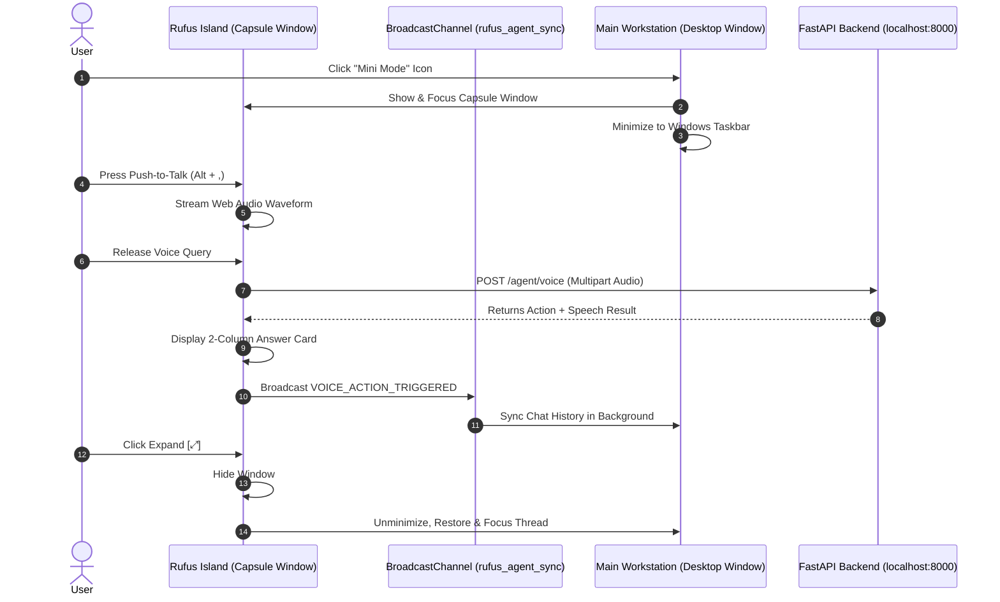

<div align="center">

  

  <p align="center">
    <strong>Ultra-low latency desktop workstation and floating Dynamic Island companion for Rufus.</strong>
  </p>

  <p align="center">
    <a href="#dynamic-island-hoverman-deep-dive"></a>
    <a href="#desktop-workstation-architecture"></a>
    <a href="#frontend-stack"></a>
    <a href="#multi-window-ipc--state-sync"></a>
    <a href="LICENSE"></a>
  </p>
</div>

---

## 📌 Executive Overview

**Rufus Desktop** (`rufus-web`) is the official native interface for the Rufus companion robot family. Built with **Tauri v2**, **React 19**, and **TypeScript**, it provides both an **expansive desktop workstation** for complex tasks and a detached, floating **Dynamic Island Capsule ("Hoverman")** that hovers seamlessly over your Windows workspace.

Rather than cluttering your screen with a bulky window, Rufus lives as an unobtrusive squircle at the top of your monitor, expanding on demand when spoken to or when physical hardware actions occur.

---

## 🐶 The Dynamic Island Capsule ("Hoverman")

The Island Capsule is a detached, transparent, always-on-top native window designed around Apple Dynamic Island and Wispr Flow ergonomics:

```
[ Ambient Rest: 64x30px ]     [ On Hover: 130x36px ]             [ Wispr Flow Waveform: 240x40px ]
       ╭──────╮                    ╭────────────────╮                 ╭─────────────────────────╮
       │ (00) │                    │ (00)   [🎤] [⤢]│                 │ [✕]   ||||||||||||  [✓] │
       ╰──────╯                    ╰────────────────╯                 ╰─────────────────────────╯
```

### The 5 Visual Interaction States

1. **Ambient Rest (Idle)**:
   * Compact 64×30px glassmorphic squircle with zero dead space.
   * Two glowing vertical cyan OLED eyes that blink naturally and react to system state.
2. **On-Hover Expansion**:
   * Hovering the cursor reveals micro-actions:
     * **Push-to-Talk Mic** (`Alt + ,`): Instantly arms voice listening.
     * **Expand to Workstation** (`⤢`): Restores the full assistant window.
3. **Wispr Flow Recording Bar**:
   * Triggered by `Alt + ,` or clicking the mic.
   * Real-time 24-band audio waveform streaming directly from the Web Audio API Analyser node with single-click `[ ✕ Cancel ]` and `[ ✓ Done ]` buttons.
4. **Processing & Radar Orbit**:
   * High-tech conical gradient radar ring orbiting the capsule perimeter while the local model reasons or an OS tool executes.
5. **Two-Column Answer Card**:
   * **Left Column**: Animated OLED face on top, quick controls below.
   * **Right Column**: Direct spoken text feedback.
   * **Smart Truncation**: Short answers ($< 140$ characters) display directly inline; long answers or code generation present a 2-line summary with a one-click `[ View in Workstation ↗ ]` shortcut.

---

## 🖥️ Multi-Window Architecture & Cross-Window Sync

Rufus uses Tauri v2's native multi-window system to decouple the floating capsule from the heavy workstation:



---

## 🎨 Atomic React 19 Component Architecture

The frontend follows strict decoupling principles:

* **Pure Presentational Components**:
  * `RufusEyesLogo`: Vector SVG eyes supporting idle blink, squint, and pulse glow animations.
  * `AudioWaveform`: Hardware-accelerated canvas/CSS waveform visualizer.
  * `ActionBadge`: High-contrast status pills for running tools (`⚡ Action: Volume 65%`, `⛔ Blocked: Allowlist`).
* **Custom Custom Hooks for State & I/O**:
  * `useAgentChat`: Manages session threads, optimistic streaming, and backend WebSocket/HTTP failover.
  * `useAudioRecorder`: Encapsulates MediaRecorder API and Web Audio Analyser node for raw PCM voice input.
  * `useTauriWindow`: Native window management, frameless drag regions, minimize/maximize, and multi-window toggling.
* **Design Tokens & Theme Invariants**:
  * Root CSS variables (`--accent-cyan: #00e5ff`, `--bg-dark: #080a12`) designed so the upcoming mobile companion (`rufus-mobile`) mirrors exact color semantics.

---

## 🛠️ Workstation Features & Controls

Beyond the island capsule, the full desktop workstation includes:

* **Command Bar**: Unibody expanding capsule input with multi-line auto-grow, file attachment chips (screenshots, PDFs, code snippets), and live engine provider switching.
* **Focus Timers**: Cyberpunk Pomodoro focus sessions synchronized to Rufus's physical OLED eyes.
* **Apps & Skills Registry**: Granular permission toggles allowing you to enable or disable specific OS tools (WhatsApp, Spotify, Calculator, Screen Vision) with one click.
* **Hardware Stunts Controller**: Real-time MQTT teleoperation triggers for the physical ESP32 quadruped dog (sit, stand, wag, dance, bark).
* **Memory Inspector**: Browse, search, and edit Rufus's persistent working memory and episodic conversation history stored in SQLite.

---

## 🚀 Quick Start & Development

### Prerequisites
* **Node.js**: 18+
* **Rust**: 1.75+ (Cargo and rustc installed via `rustup`)
* **Rufus Backend**: Running at `http://127.0.0.1:8000`

### Step 1: Install Dependencies
```bash
git clone https://github.com/AnonAjay/rufus-web.git
cd rufus-web

npm install
```

### Step 2: Run in Development Mode
Launches Vite dev server (`http://localhost:1420`) and compiles the native Tauri desktop shell:
```bash
npm run tauri dev
```

### Step 3: Test Dynamic Island Capsule
* Click the **Mini Mode** icon in the custom TitleBar, or press the global shortcut to switch to the floating island.
* Use `Alt + ,` anywhere in Windows to trigger Push-to-Talk voice capture.

### Step 4: Build Production Executable
Compiles an optimized, lightweight native `.exe` installer under `src-tauri/target/release/bundle/`:
```bash
npm run tauri build
```

---

## 📂 Repository Directory Map

```
rufus-web/
├── src/
│   ├── components/
│   │   ├── capsule/            # Dynamic Island Capsule ("Hoverman")
│   │   │   ├── IslandCapsule.tsx    # State Machine & Layouts
│   │   │   └── IslandCapsule.css    # Squircle Glassmorphism & Animations
│   │   ├── chat/               # CommandBar, ChatBubble, ThinkingIndicator
│   │   ├── layout/             # Frameless TitleBar, Sidebar, ViewHeader
│   │   ├── productivity/       # FocusTimers, TasksReminders
│   │   ├── apps/               # Apps & Skills Allowlist Inspector
│   │   └── stunts/             # ESP32 Robot Stunt Teleoperation
│   ├── hooks/                  # Reusable Custom Hooks (Audio, Chat, Tauri Window)
│   ├── types/                  # Typed Data Contracts & Agent Schemas
│   ├── App.tsx                 # Main Workstation Shell
│   ├── CapsuleApp.tsx          # Standalone Island Native Window Root
│   └── main.tsx                # Dynamic View Routing (workstation vs. capsule)
├── src-tauri/                  # Rust Native Backend & Window Config
│   ├── tauri.conf.json         # Multi-Window Configuration (Main + Capsule)
│   └── src/                    # Rust IPC Commands & Entrypoint
└── package.json
```

---

## 📄 License
Licensed under the [MIT License](LICENSE).
